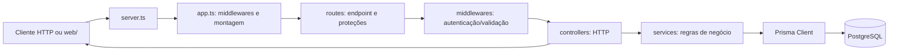

# Onboarding do StockHub

Guia para acompanhar o caminho de uma requisição desde o HTTP até o PostgreSQL. A organização descrita aqui reflete o código atual do repositório; os pontos marcados como **limitação atual** não devem ser confundidos com funcionalidades completas.

## 1. Visão geral da arquitetura

O backend usa uma arquitetura **em camadas, inspirada em MVC**, sem ser um MVC estrito. A API concentra-se em rotas, controllers e services; a interface React fica separada em `web/`.



### Pastas e arquivos

| Caminho | Responsabilidade |
| --- | --- |
| `src/server.ts` | Carrega variáveis de ambiente e inicia o listener HTTP. |
| `src/app.ts` | Configura Express, CORS, JSON, paginação, Swagger, rotas e erros. |
| `src/routes/` | Mapeia caminhos HTTP para controllers e define middlewares por rota. |
| `src/controllers/` | Lê `req`, chama services e escolhe status/resposta HTTP. |
| `src/services/` | Valida entradas, aplica regras de negócio e usa Prisma. |
| `src/middlewares/` | Código transversal, como autenticação, autorização, paginação e erros. |
| `src/types/` | Tipos compartilhados, enum de papéis e `AppError`. |
| `src/utils/` | Funções reutilizáveis: hash de senha, JWT e mapeamento de usuário. |
| `src/lib/` | Dependências compartilhadas; `prisma.ts` exporta um `PrismaClient` singleton. |
| `src/docs/` | Documento OpenAPI servido pelo Swagger em `/api/docs`. |
| `prisma/` | Schema Prisma, migrations e seed. |
| `tests/` | Testes automatizados de schemas e regras selecionadas. |
| `web/` | Front-end React/Vite que chama a API em `/api`. |

A separação é útil porque a regra de negócio não precisa conhecer detalhes de HTTP. Por exemplo, o service de movimentação pode ser testado sem iniciar o Express. Não existe uma camada Repository separada: os services chamam o Prisma diretamente.

### Inicialização

`src/server.ts` importa `dotenv/config`, importa o app e inicia o servidor na porta definida por `PORT` (ou 3000 por padrão). `src/app.ts` registra os middlewares antes das rotas:

```ts
app.use(cors());
app.use(express.json());
app.use(paginationMiddleware);
app.use('/api/docs', swaggerUi.serve, swaggerUi.setup(swaggerDocument));
app.use('/api', routes);
```

A ordem importa: uma requisição passa pelos middlewares registrados antes de chegar ao endpoint. Rotas desconhecidas recebem 404; erros encaminhados ao Express chegam ao `errorHandler`.

## 2. Banco de dados e modelagem

A fonte do modelo é [`prisma/schema.prisma`](prisma/schema.prisma). O Prisma Client é gerado a partir dele e traduz consultas TypeScript em SQL para PostgreSQL.

### Entidades

- **User (`users`)**: conta com `id` UUID, nome, e-mail único e hash da senha. Relaciona-se com papéis, movimentações registradas e tokens de recuperação.
- **Role (`roles`)**: nome único de papel, como `ADMIN` ou `USER`.
- **User ↔ Role**: relação N:M. Um usuário pode ter vários papéis e cada papel pode estar em várias contas. O Prisma mantém a tabela intermediária implícita `_users_roles`.
- **PasswordResetToken (`password_reset_tokens`)**: guarda hash do token, usuário, expiração e criação. O hash é único; há índice por usuário/expiração; apagar o usuário apaga os tokens em cascata.
- **Categoria (`categorias`)**: nome e descrição. Uma categoria tem vários produtos.
- **Produto (`produtos`)**: nome, SKU único, descrição opcional, preço `Decimal(10,2)`, quantidade, estoque mínimo e `categoriaId`.
- **MovimentacaoEstoque (`movimentacoes_estoque`)**: produto, usuário que registrou, tipo, quantidade, observação e data.
- **Pessoa (`pessoas`)**: base comum para pessoa física/jurídica, com `tipoPessoa`.
- **PessoaFisica (`pessoas_fisicas`)**: CPF, nome e `pessoaId`.
- **PessoaJuridica (`pessoas_juridicas`)**: CNPJ, razão social e `pessoaId`.
- **Cliente (`clientes`)**: registro de cliente, `pessoaId` único e datas.

### Relações garantidas pelo schema

```text
Categoria 1 ── N Produto
Produto   1 ── N MovimentacaoEstoque
User      1 ── N MovimentacaoEstoque
User      1 ── N PasswordResetToken
User      N ── M Role
```

O `1` representa um registro relacionado e `N` vários. As relações Produto/Categoria, Produto/Movimentação, User/Movimentação e User/ResetToken têm campos `@relation` no schema e geram chaves estrangeiras.

### Limitação do modelo de cliente

O código de `ClienteService` cria uma linha em `Pessoa`, outra em `PessoaFisica` ou `PessoaJuridica` e uma em `Cliente`, usando o mesmo identificador. Porém, no schema atual, os campos `pessoaId` dessas três tabelas não declaram `@relation`. Assim, o banco não cria FKs para essa associação: o vínculo é uma convenção da aplicação, não uma garantia referencial do PostgreSQL. `rg` não é necessário para enxergar isso: basta conferir se existe uma diretiva `@relation` nos modelos.

`@@map("...")` troca o nome físico da tabela. `@map("created_at")` troca o nome físico de uma coluna específica. Por exemplo, o campo Prisma `Categoria.createdAt` usa a coluna `created_at`.

## 3. Jornada do dado: registrar movimentação

Endpoint: `POST /api/movimentacoes`, com token Bearer e JSON semelhante a:

```json
{
  "produtoId": "id-do-produto",
  "tipo": "SAIDA",
  "quantidade": 2,
  "observacao": "Pedido de venda"
}
```

1. `server.ts` inicializa o Express; `app.ts` interpreta JSON, instala paginação e monta as rotas em `/api`.
2. `routes/index.ts` monta `movimentacao.route.ts` em `/movimentacoes`.
3. `movimentacao.route.ts` aplica `router.use(authenticate)`. Portanto, todas as rotas de movimentação exigem `Authorization: Bearer <token>`.
4. `authenticate` valida o JWT, busca o usuário e seus papéis no banco e coloca o resultado em `req.user`.
5. `MovimentacaoController.registrarMovimentacao` pega `req.user.id` e envia identidade e corpo ao service.
6. `MovimentacaoService` valida tipo, produto, quantidade positiva e observação com Zod.
7. O service abre uma transação Prisma, busca o produto e confere o saldo.
8. Para `ENTRADA`, incrementa `Produto.quantidade`. Para `SAIDA`, tenta decrementar somente se o saldo no banco ainda for maior ou igual à quantidade solicitada.
9. Ainda dentro da transação, grava o histórico com produto, usuário, tipo, quantidade e observação.
10. Se a operação termina bem, o controller retorna `201`. Se falha, a transação é revertida e o controller traduz o erro em resposta HTTP.

A proteção da saída não depende apenas da checagem anterior: o próprio `UPDATE` também exige saldo suficiente. Isso reduz o risco de duas requisições concorrentes retirarem as mesmas unidades.

```ts
const updated = await transaction.produto.updateMany({
  where: { id: produto.id, quantidade: { gte: data.quantidade } },
  data: { quantidade: { decrement: data.quantidade } },
});
```

A query retorna `count`. Se for zero, o saldo não permitiu a saída e o service lança `AppError` com status 409.

### Exemplo curto: listagem de produtos

`GET /api/produtos?page=1&limit=10&q=teclado` também passa por `authenticate`. O middleware global de paginação valida `page`, `limit` e `q`; o controller repassa esses valores ao `ProdutoService`; o service aplica `skip`/`take`, busca por nome ou SKU e ordena por nome; o controller devolve JSON com status 200.

## 4. Middlewares e utilitários

### Autenticação e autorização

- `authenticate` exige um header `Bearer`, valida assinatura/expiração do JWT e recarrega o usuário do banco. Se faltar token ou ele for inválido, a requisição falha com 401.
- `authorize(UserRole.ADMIN)` verifica o papel já carregado. Usuário autenticado sem o papel exigido recebe 403.
- O cadastro público associa sempre `USER`; não permite enviar `ADMIN` ou `GUEST` no corpo.
- A leitura do papel no banco em cada requisição permite que alterações de papel tenham efeito sem depender do conteúdo antigo do token.

### Paginação e erros

`paginationMiddleware` usa Zod para validar `page` positivo, `limit` positivo até 100 e busca `q` limitada. Os valores validados ficam em `req.pagination`.

`errorHandler` converte `AppError`, `ZodError` e alguns erros Prisma em respostas HTTP. Há uma inconsistência atual: autenticação/dashboard encaminham erros ao handler global, enquanto controllers de produto/movimentação tratam vários erros localmente.

### Utilitários

- `password.ts`: `hashPassword` usa bcrypt com 10 salt rounds; `comparePasswords` compara senha recebida ao hash salvo. A senha não deve ser guardada em texto puro.
- `jwt.ts`: assina token com subject (ID), e-mail e papéis. Expiração padrão: uma hora. Em produção, exige `JWT_SECRET` com pelo menos 32 caracteres; em desenvolvimento usa segredo local fixo.
- `user.mapper.ts`: converte papéis para valores conhecidos do enum e monta resposta pública sem campo de senha.
- `prisma.ts`: cria uma instância compartilhada de `PrismaClient`.

### Login e recuperação

`POST /api/auth/login` valida e-mail/senha, procura usuário, compara bcrypt e emite JWT. `POST /api/auth/register` valida nome, e-mail e senha forte e cria papel `USER`.

Para recuperação, `forgot-password` responde com a mesma mensagem exista ou não o e-mail, evitando revelar quais contas estão cadastradas. Se existir, gera token aleatório, guarda somente o hash, define validade de 30 minutos e envia link por SMTP (Mailpit no ambiente local). `reset-password` valida o hash e a validade, troca a senha e consome o token.

## 5. Regras de negócio e limitações atuais

- **Papéis:** `ADMIN`, `USER` e `GUEST` estão definidos no enum. O cadastro cria `USER`; `GUEST` não tem fluxo de atribuição nem política específica implementada.
- **Usuários:** rotas de gerenciamento exigem `ADMIN`. O cadastro público não dá privilégios administrativos.
- **Categorias:** qualquer usuário autenticado pode consultar; somente `ADMIN` pode criar, editar e excluir.
- **Produtos:** as rotas exigem autenticação, mas não exigem papel específico. Portanto, hoje qualquer conta autenticada pode listar, criar, atualizar e excluir produtos.
- **Movimentações:** qualquer conta autenticada pode registrar entrada/saída e consultar histórico; não há regra de papel diferente entre estoquista e admin nessas rotas.
- **Estoque:** a quantidade inicial de produto não pode ser negativa; movimentações exigem inteiro positivo; saída sem saldo suficiente retorna conflito 409.
- **SKU:** é único. Duplicidade retorna 409. Produto precisa referenciar categoria existente.
- **Estoque baixo:** é `quantidade <= estoqueMinimo`. O dashboard calcula produtos, unidades totais, valor em estoque e quantidade de itens abaixo/igual ao mínimo.
- **Clientes PF/PJ:** o service valida CPF/CNPJ em formato pontuado, mas o schema não persiste RG nem inscrição estadual. Busca/listagem e exclusão são simples; não há autorização por papel além do login.
- **Seed:** sempre prepara categorias e o papel `USER`. Se `SEED_ADMIN_PASSWORD` for definida, também cria/atualiza admin e dados demonstrativos de produtos/movimentações.

## 6. Testes e fluxo de trabalho

`npm test` executa os testes em `tests/`. A cobertura atual inclui validação de credenciais, validação de usuário, aceitação de tipos de movimentação, rejeição de quantidade inválida e bloqueio de saída sem saldo. Não é uma suíte completa de integração com PostgreSQL: a regra de saída insuficiente usa um objeto transacional simulado.

Comandos principais:

```powershell
npm run dev             # API Express
npm run web:dev         # Interface Vite
npm run build           # Compilar API
npm run web:typecheck   # Verificar tipos do front-end
npm test                # Testes automatizados
npx prisma validate     # Validar schema
npx prisma db push      # Sincronizar schema sem migrations
npx prisma migrate status
```

O schema e o histórico de migrations são coisas distintas. No ambiente usado durante este onboarding, o banco tinha registros de migrations que não correspondiam aos arquivos locais; `db push` sincronizou o schema, mas não reconstruiu o histórico. Evite `prisma migrate reset` sem entender o impacto: esse comando pode apagar dados. Antes de usar migrations como fluxo definitivo ou implantar em outro ambiente, reconcilie/baseline o histórico com cuidado.

## Perguntas de fixação

1. Por que o decremento de uma saída e a criação do histórico ficam na mesma transação?
2. Qual é a diferença entre `authenticate` e `authorize(UserRole.ADMIN)`?
3. O que o banco garante na relação Produto/Categoria que não garante hoje na associação Cliente/Pessoa?

Tente responder sem consultar o guia. Depois, compare com o código apontado nas seções acima ou envie suas respostas para revisão.
